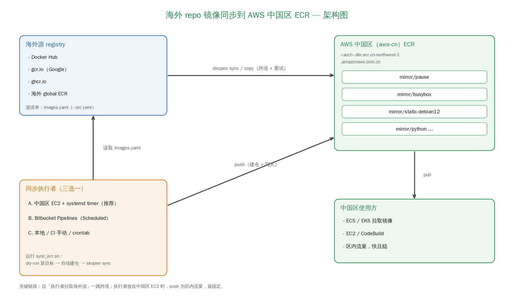

# 海外 repo 镜像长期同步到 AWS 中国区 ECR 方案（基于 skopeo）

> 本文档说明如何用 skopeo 将「海外容器镜像仓库（Docker Hub / gcr.io / ghcr.io / 海外 ECR 等）」
> 的镜像，长期、增量、自动地同步到「AWS 中国区 ECR（partition `aws-cn`）」，
> 并给出已在 `cn-northwest-1` 实测通过的验证过程。

---

## 目录
- 1. 方案概览
- 2. 简要架构图
- 3. 所需资源
- 4. 部署前变量
- 5. 部署流程
- 6. 长期同步的三种落地方式
- 7. 实际验证（已在 cn-northwest-1 跑通）
- 8. 运维建议
- 9. 附录

---

## 1. 方案概览

面向「海外构建 / 公共基础镜像 → 中国区使用」的常见跨境场景。中国区没有全球 CloudFront、
到海外 registry 的链路慢且抖动，直接 `docker pull/push` 既慢又不稳。本方案用 **skopeo**
做 registry 到 registry 的直传（无需 Docker daemon、无需本地落盘），并封装成可长期定时运行的同步器。

核心能力：

- **跨境直传**：`skopeo copy` / `skopeo sync` 在海外源与中国区 ECR 之间直接搬运镜像层。
- **批量清单驱动**：用 `images.yaml` 声明要同步的源镜像与 tag，支持正则、语义化版本过滤。
- **自动建仓**：先用 `--dry-run` 计算目标仓库名，再自动在中国区 ECR 预创建缺失仓库
  （ECR 不会在 push 时自动建仓）。
- **增量同步**：目标已存在的镜像自动跳过（`Skipping: image already present`），适合长期定时跑。
- **跨境韧性**：`--retry-times` 应对链路抖动，`--keep-going` 单镜像失败不影响其余。
- **分区安全**：全部使用 `arn:aws-cn:` 与 `*.amazonaws.com.cn` endpoint。

---

## 2. 简要架构图



> 架构图源文件：`ext/docgen/make_arch_png.py`（用 Pillow 生成 `ext/docgen/arch.png`，
> 避免 ASCII 图在 Word/PDF 里格式跑版）。

- **同步执行者**：运行 `sync_ecr.sh` 的主体。推荐放在**中国区 EC2** 上（systemd timer 定时），
  这样 push 到 ECR 是区内流量，只有「拉取海外源」一跳跨境，最稳。
- **skopeo**：真正执行 registry→registry 传输的工具，不依赖 Docker daemon。
- **中国区 ECR**：目标仓库，统一收敛在 `mirror/` 命名空间下。

---

## 3. 所需资源

| 资源 | 描述 | 潜在成本 |
|---|---|---|
| ECR（中国区） | 存放同步后的镜像，统一在 `mirror/*` 命名空间 | 按存储量 + 跨区/跨境流量计费 |
| 同步主机 | 运行 skopeo 的 EC2（推荐中国区）或 Bitbucket runner（海外） | EC2 按实例计费；CI 按分钟计费 |
| IAM | 授予同步身份对 ECR 的最小权限 | IAM 本身不收费 |
| skopeo / aws cli / jq | 同步主机上的依赖工具 | 无 |

> 本方案不改动海外源，只做「读取海外 + 写入中国区 ECR」。

---

## 4. 部署前变量

```bash
export AWS_REGION="cn-northwest-1"                 # 或 cn-north-1
export AWS_ACCOUNT_ID="123456789012"               # 中国区账号 12 位 ID
export DEST_BASE_PATH="mirror"                     # 中国区 ECR 统一命名空间前缀
export ECR_HOST="${AWS_ACCOUNT_ID}.dkr.ecr.${AWS_REGION}.amazonaws.com.cn"
```

> 若目标改为全球区，请把 endpoint 由 `*.amazonaws.com.cn` 改回 `*.amazonaws.com`，
> 并把 IAM ARN 前缀由 `arn:aws-cn` 改回 `arn:aws`。

安装依赖（Ubuntu 24.04 示例）：

```bash
sudo apt-get update && sudo apt-get install -y skopeo jq
# aws cli v2 按官方文档安装
skopeo --version   # 本方案在 skopeo 1.13.3 上验证通过
```

---

## 5. 部署流程

### 5.1 准备文件

```
s2/ext/
├── sync/
│   ├── sync_ecr.sh      # 同步主脚本（自动建仓 + skopeo sync）
│   └── images.yaml      # 源镜像清单
├── iam/
│   └── ecr-sync-policy.json   # 最小权限策略（仅 mirror/* 可推送）
├── schedule/
│   ├── ecr-sync.service # systemd 一次性服务
│   ├── ecr-sync.timer   # systemd 定时器
│   └── crontab.example  # crontab 替代方案
└── pipeline/
    └── bitbucket-pipelines.yml  # Bitbucket CI 同步/推送示例
```

### 5.2 创建同步身份与权限

把 `ext/iam/ecr-sync-policy.json` 里的 `AWS_ACCOUNT_ID` 替换为实际账号，然后：

```bash
# 推荐：给中国区 EC2 绑定 IAM Role（免长期密钥）
aws iam create-policy \
  --policy-name ecr-sync-policy \
  --policy-document file://ext/iam/ecr-sync-policy.json

# 将策略附加到 EC2 Role 或 CI 使用的 IAM 用户
```

该策略只允许对 `mirror/*` 仓库推送，并允许 `CreateRepository` 以支持自动建仓。

### 5.3 编辑同步清单

编辑 `ext/sync/images.yaml`，声明要同步的海外镜像。格式与行为见第 9.1 节。

### 5.4 首次执行

```bash
cd ext/sync
# 先预演，确认 源->目标 映射与将创建的仓库
AWS_REGION=cn-northwest-1 ./sync_ecr.sh --dry-run
# 正式同步
AWS_REGION=cn-northwest-1 ./sync_ecr.sh
```

---

## 6. 长期同步的三种落地方式

### 方式 A（推荐）：中国区 EC2 + systemd timer
把 `sync_ecr.sh`、`images.yaml` 放到中国区 EC2 的 `/opt/ecr-sync/`，安装 systemd 单元：

```bash
sudo cp ext/schedule/ecr-sync.service /etc/systemd/system/
sudo cp ext/schedule/ecr-sync.timer   /etc/systemd/system/
sudo systemctl daemon-reload
sudo systemctl enable --now ecr-sync.timer
systemctl list-timers ecr-sync.timer      # 查看下次触发
```
优点：push 走区内流量，只有拉取海外源一跳跨境，最稳；配合 EC2 IAM Role 免密钥。

### 方式 B：Bitbucket Pipelines（Scheduled）
用 `ext/pipeline/bitbucket-pipelines.yml` 的 `custom: sync-mirror` 流水线，
在 Bitbucket 的 **Scheduled Pipelines** 里配置定时（如每天一次）。
适合源就是 Bitbucket/海外、且不想维护 EC2 的团队。注意 runner 在海外，跨境发生在 push 阶段。

### 方式 C：crontab
systemd 不可用时，用 `ext/schedule/crontab.example` 里的定时行。

---

## 7. 实际验证（已在 cn-northwest-1 跑通）

以下为真实执行结果，账号 `594972105935`、区域 `cn-northwest-1`，覆盖 <1MB 到 100MB+ 的镜像。

### 7.1 单镜像跨境复制（gcr.io google 源 → 中国区 ECR）
```
skopeo copy --all --retry-times 5 \
  docker://gcr.io/distroless/static-debian12:latest \
  docker://<acct>.dkr.ecr.cn-northwest-1.amazonaws.com.cn/skopeo-sync-test/distroless-static:latest \
  --dest-creds "AWS:$ECR_PWD"
# => Writing manifest list to image destination / Storing list signatures（成功，5 架构 manifest）
```
校验：
```
aws ecr describe-images --repository-name skopeo-sync-test/distroless-static --region cn-northwest-1
# => tags: ["latest"]，每架构镜像约 0.7MB
```
另外实测了一个 100MB+ 镜像 `docker.io/library/eclipse-temurin:17-jre`（压缩体积
104.7MB，单架构）：跨境同步耗时约 72s，明显高于小镜像，体现大镜像跨境传输的真实成本。

### 7.2 清单批量同步（gcr.io + docker.io → 中国区 ECR）
`sync_ecr.sh` 自动：dry-run 计算目标仓库 → 建仓 → 同步。实测数据（压缩体积为 amd64
各层之和，即实际跨境传输字节；同步耗时为单架构 skopeo copy 墙钟时间，首次写入、非增量跳过）：

| 目标仓库（中国区 ECR） | 来源 | tag | 压缩体积 | 同步耗时 | 结果 |
|---|---|---|---|---|---|
| `mirror/pause` | gcr.io/google-containers/pause | 3.2 | 0.3 MB | 4.2s | ✅ |
| `mirror/busybox` | docker.io/library/busybox | latest | 2.1 MB | 2.9s | ✅ |
| `mirror/static-debian12` | gcr.io/distroless/static-debian12 | latest | 0.7 MB | 2.8s | ✅ |
| `mirror/python` | docker.io/library/python | 3.12-slim | 41.3 MB | 约 3s | ✅ |
| `mirror/eclipse-temurin` | docker.io/library/eclipse-temurin | 17-jre | 104.7 MB | 72.1s | ✅ |

> 测试环境：cn-northwest-1，账号 594972105935，skopeo 1.13.3，单架构（amd64）。
> 耗时随跨境链路质量波动；小镜像耗时主要来自建连握手，故 0.3MB 的 pause 反而略久；
> 而 100MB+ 的 eclipse-temurin 耗时显著上升（72s），体现大镜像跨境传输的真实成本——
> 生产环境应优先把同步主机放在中国区 EC2（push 走区内流量）。
> 多架构（`--all`）会同步全部平台，体积与耗时成倍增加。

关键日志：
```
[..] 创建仓库：mirror/pause
[..] 开始同步 海外源 -> 中国区 ECR ...
level=info msg="Synced 2 images from 2 sources"
Skipping: image already present at destination   # 再次运行时增量跳过
```

### 7.3 结论
- 海外公共源（**google 的 gcr.io**、**Docker Hub**）→ 中国区 ECR 跨境同步 **验证通过**。
- 自动建仓、增量跳过、多架构 `--all` 均按预期工作。
- ≤100MB 的镜像同步稳定；多架构 `--all` 会成倍放大体积，跨境耗时明显增加（见 8.3）。

---

## 8. 运维建议

### 8.1 目标仓库命名（重要，已实测）
skopeo sync 的目标仓库名 = `<dest-base>/<源仓库路径的最后一段>`：

- `docker.io/library/busybox` → `mirror/busybox`
- `gcr.io/google-containers/pause` → `mirror/pause`

命名空间 `library/`、`google-containers/` 等**会被丢弃**，只保留最后一段。
若不同源存在同名仓库（如都叫 `app`）会冲突，此时改用 `skopeo sync --scoped`
（以源完整路径为前缀）或在清单里拆分不同 `DEST_BASE_PATH`。
`sync_ecr.sh --dry-run` 是确认最终仓库名的权威方式。

### 8.2 ECR 不自动建仓
ECR 在 push 时**不会**自动创建仓库，缺仓库会报 `name unknown ... does not exist`。
`sync_ecr.sh` 已通过「dry-run 取仓库名 → CreateRepository」解决。新增源镜像后无需手动建仓。

### 8.3 多架构与体积控制
- `--all` 会同步 manifest list 下**所有架构**，体积成倍增长、跨境更慢。
  只需单架构时，去掉脚本里的 `--all`（skopeo 默认只取当前 OS/架构）。
- 用固定 tag 或 `images-by-tag-regex` 收窄范围，避免 `[]`（全 tag）一次拉取过多。

### 8.4 跨境稳定性
- 把同步主机放在**中国区 EC2**（方式 A），push 变区内流量，最稳。
- 保留较高的 `RETRY_TIMES`（默认 5）。CI 单 step 有时长上限，超大镜像优先用方式 A。
- 发行版自带 skopeo（如 1.13.3）的 `sync` 子命令**不支持 `--retry-delay`**，脚本已避开。

### 8.5 凭证
- `aws ecr get-login-password` 生成的是 ~12 小时临时口令，无需长期存储。
- 优先用 EC2 IAM Role / CI OIDC；必须用 AK/SK 时，权限限定为 `ext/iam/ecr-sync-policy.json`。

### 8.6 生命周期与清理
为 `mirror/*` 配置 ECR Lifecycle Policy，自动清理过期/未打 tag 的历史镜像，控制存储成本。

---

## 9. 附录

### 9.1 images.yaml 格式
```yaml
<源 registry 主机名>:
  images:
    <仓库路径>:
      - "<tag>"        # 指定 tag；[] 表示全部 tag（慎用）
  images-by-tag-regex:
    <仓库路径>: '<正则>'      # 仅匹配的 tag
  images-by-semver:
    <仓库路径>: ">= 3.12.0"   # 语义化版本约束
```
本文件只描述「源」；目标 ECR 与凭证由 `sync_ecr.sh` 命令行注入，不在此写明文口令。

### 9.2 sync_ecr.sh 可配置环境变量
| 变量 | 默认 | 说明 |
|---|---|---|
| `AWS_REGION` | `cn-northwest-1` | 目标区域 |
| `AWS_ACCOUNT_ID` | 自动探测 | 中国区账号 |
| `DEST_BASE_PATH` | `mirror` | ECR 统一命名空间前缀 |
| `IMAGES_YAML` | `./images.yaml` | 清单路径 |
| `RETRY_TIMES` | `5` | 跨境重试次数 |
| `SCAN_ON_PUSH` | `false` | 新建仓库是否开启扫描 |

### 9.3 常用命令
```bash
# 预演（不写数据），确认 源->目标 与将建仓库
./sync_ecr.sh --dry-run
# 校验某仓库 tag
aws ecr describe-images --repository-name mirror/busybox --region cn-northwest-1 \
  --query 'imageDetails[?imageTags!=`null`].imageTags[]'
# 从中国区 ECR 反查 manifest（确认多架构）
skopeo inspect --raw docker://$ECR_HOST/mirror/static-debian12:latest --creds "AWS:$(aws ecr get-login-password --region cn-northwest-1)"
```

### 9.4 文件对应关系
| 文件 | 说明 |
|---|---|
| `ext/sync/sync_ecr.sh` | 同步主脚本：dry-run 计算目标 + 自动建仓 + skopeo sync |
| `ext/sync/images.yaml` | 源镜像清单（已含 gcr.io/docker.io 实测样例） |
| `ext/iam/ecr-sync-policy.json` | 最小权限 IAM 策略（仅 `mirror/*` 可推送） |
| `ext/schedule/ecr-sync.service` | systemd 一次性服务单元 |
| `ext/schedule/ecr-sync.timer` | systemd 定时器（长期同步） |
| `ext/schedule/crontab.example` | crontab 定时替代方案 |
| `ext/pipeline/bitbucket-pipelines.yml` | Bitbucket CI 同步/推送示例 |
| `ext/docgen/make_arch_png.py` | 架构图生成脚本（Pillow → arch.png） |
| `ext/docgen/arch.png` | 架构图图片（README 第 2 节引用） |
